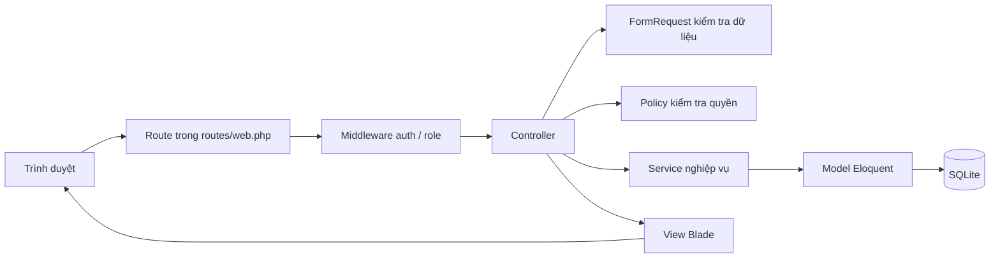

# Kiến trúc tổng thể

Project dùng **Laravel 13** (PHP 8.3), không phải PHP thuần. Cơ sở dữ liệu mặc định là **SQLite** (`DB_CONNECTION=sqlite`). Đăng nhập dùng **session**, không dùng JWT.

## Từ lúc mở trình duyệt đến lúc thấy dữ liệu

1. **Request**: trình duyệt gửi GET/POST tới một URL, kèm cookie session và (với form) token CSRF.
2. **Route**: `routes/web.php` chọn controller nào xử lý URL đó.
3. **Middleware**:
   - `auth`: chưa đăng nhập thì chuyển `/login`.
   - `role:student|employer|admin`: sai vai trò thì 403.
   - `EnsureUserIsActive`: tài khoản bị khóa thì không vào được.
4. **Controller**: nhận request, gọi service, trả view hoặc redirect.
5. **Model**: một class tương ứng một bảng. Không viết SQL nối chuỗi — Eloquent dùng parameterized query (chống SQL Injection).
6. **View**: file Blade in HTML. `{{ $bien }}` tự escape HTML (chống XSS). `{!! !!}` không dùng cho dữ liệu người dùng nhập.
7. **Session**: sau login, Laravel lưu `user_id` trong session. `auth()->user()` lấy user hiện tại từ đó, **không** tin `user_id` gửi từ form.

Vì sao tách Controller / Service / Model:

- Controller chỉ điều phối HTTP.
- Service chứa quy tắc nghiệp vụ (ví dụ: chỉ trúng tuyển mới được đánh giá).
- Model nói chuyện với bảng.

Nếu nhét hết vào một file, giảng viên hỏi “chỗ nào kiểm tra quyền?” sẽ rất khó trả lời.

## Vai trò đang có

Enum `App\Enums\Role`: `student`, `employer`, `admin`. Không có vai trò nhân viên hỗ trợ riêng — admin đảm nhiệm hỗ trợ.

## Trạng thái đơn ứng tuyển

Enum `App\Enums\ApplicationStatus` đã có sẵn: `pending`, `viewed`, `shortlisted`, `interview`, `hired`, `rejected`.

**Trúng tuyển = `hired`**. Chức năng đánh giá công ty dùng đúng trạng thái này, không tạo hệ thống trạng thái mới.
